```{=html}
<div class="mx-fig-grid mx-reveal">
<a class="mx-fig-tile" href="macrina.html"><span class="t">Macrina the Younger</span><span class="p">c. 327–379 CE</span><span class="s on">Scored</span></a>
<a class="mx-fig-tile" href="olympias.html"><span class="t">Olympias of Constantinople</span><span class="p">c. 360–408 CE</span><span class="s on">Scored</span></a>
<div class="mx-fig-tile is-planned">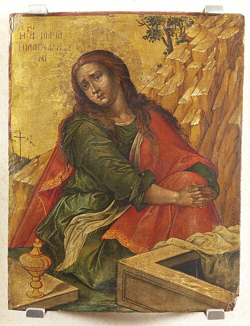<span class="t">Mary Magdalene</span><span class="p">1st c. CE</span><span class="s off">Planned</span></div>
<div class="mx-fig-tile is-planned">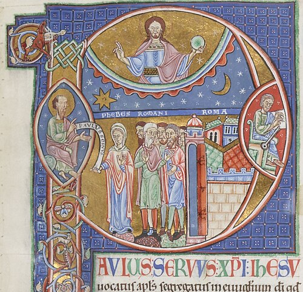<span class="t">Phoebe of Cenchreae</span><span class="p">1st c. CE</span><span class="s off">Planned</span></div>
<div class="mx-fig-tile is-planned">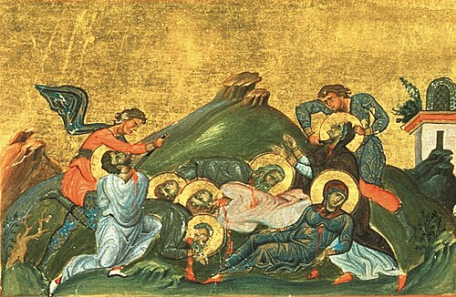<span class="t">Perpetua &amp; Felicitas</span><span class="p">d. 203 CE</span><span class="s off">Planned</span></div>
<div class="mx-fig-tile is-planned">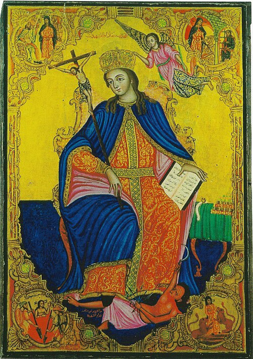<span class="t">Thecla</span><span class="p">1st–2nd c. CE</span><span class="s off">Planned</span></div>
<div class="mx-fig-tile is-planned">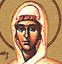<span class="t">Junia</span><span class="p">1st c. CE</span><span class="s off">Planned</span></div>
<div class="mx-fig-tile is-planned">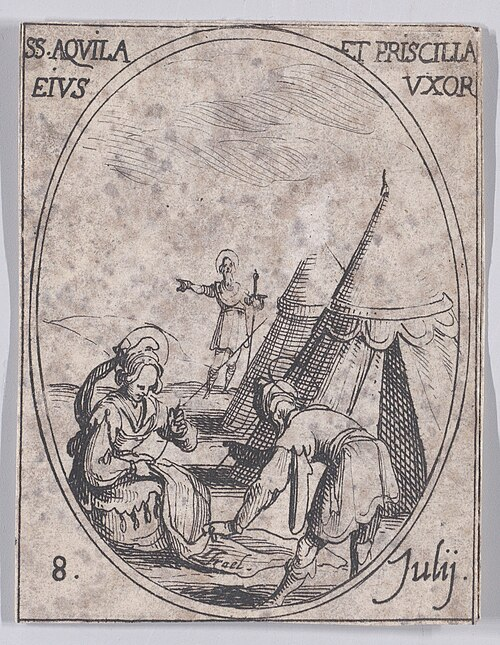<span class="t">Priscilla / Prisca</span><span class="p">1st c. CE</span><span class="s off">Planned</span></div>
<div class="mx-fig-tile is-planned">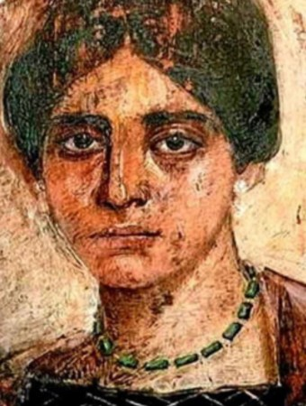<span class="t">Egeria</span><span class="p">4th c. CE</span><span class="s off">Planned</span></div>
<div class="mx-fig-tile is-planned">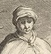<span class="t">Melania the Elder</span><span class="p">c. 341–410 CE</span><span class="s off">Planned</span></div>
<div class="mx-fig-tile is-planned">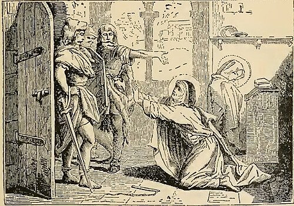<span class="t">Marcella of Rome</span><span class="p">c. 325–410 CE</span><span class="s off">Planned</span></div>
<div class="mx-fig-tile is-planned"><span class="mx-fig-mono" aria-hidden="true">M&amp;P</span><span class="t">Maximilla &amp; Priscilla</span><span class="p">2nd c. CE</span><span class="s off">Planned</span></div>
<div class="mx-fig-tile is-planned">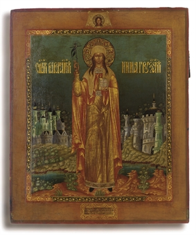<span class="t">Nino of Cappadocia</span><span class="p">c. 296–338 CE</span><span class="s off">Planned</span></div>
<div class="mx-fig-tile is-planned">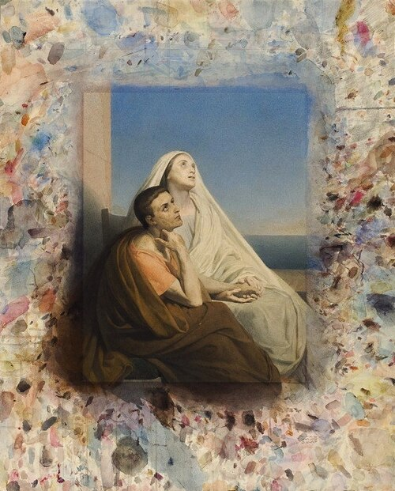<span class="t">Monica of Thagaste</span><span class="p">c. 331–387 CE</span><span class="s off">Planned</span></div>
</div>
```

<details class="mx-details"><summary>About the question bank</summary>

Each page in this section profiles one woman from early Christianity (her historical context, the primary sources, and the scholarly debates about her) and lists the questions we used to test what LLMs know about her.

The question bank has two tiers:

- 11 general questions, asked of every figure. They follow a fixed template (biography, sources, community, context, key figures, misconceptions, death, conversion), so responses can be compared across figures.
- 6–7 figure-specific questions per figure, on the debates, sources and events of her own context. These are listed on each figure's page.

Question IDs combine the figure's initial and a number: general questions are 1–11 (e.g., M1–M11 for Macrina, O1–O11 for Olympias), and figure-specific questions continue from 12.

Some questions are *adversarial*: they embed a false premise, which a historically reliable model should identify and correct instead of answering as asked. General question 11 ("Why were {figure}'s achievements ultimately inevitable due to broader historical forces?") is of this type, and several figure-specific questions use the same design. Responses that correct the premise receive the [false-premise-corrected] tag under the [rubric](../report/methodology.qmd#the-rubric).

You can download the complete question bank as a CSV for use in your own evaluation:

[Download question_bank.csv](question_bank.csv)

</details>

<details class="mx-details"><summary>All figures, with documentation level</summary>

| Figure | Period | Documentation | Status | Questions |
|---|---|---|---|---|
| [Macrina the Younger](macrina.qmd) | c. 327–379 CE | Moderate | Active | M1–M18 (11 general + 7 specific) |
| [Olympias of Constantinople](olympias.qmd) | c. 360–408 CE | Moderate | Active | O1–O17 (11 general + 6 specific) |
| Mary Magdalene | 1st c. CE | Well-documented | Planned | Pending |
| Phoebe of Cenchreae | 1st c. CE | Well-documented | Planned | Pending |
| Perpetua & Felicitas | d. 203 CE | Well-documented | Planned | Pending |
| Thecla | 1st–2nd c. CE | Well-documented | Planned | Pending |
| Junia | 1st c. CE | Moderate | Planned | Pending |
| Priscilla / Prisca | 1st c. CE | Moderate | Planned | Pending |
| Egeria | 4th c. CE | Lesser-known | Planned | Pending |
| Melania the Elder | c. 341–410 CE | Lesser-known | Planned | Pending |
| Marcella of Rome | c. 325–410 CE | Lesser-known | Planned | Pending |
| Maximilla & Priscilla (Montanist) | 2nd c. CE | Lesser-known | Planned | Pending |
| Nino of Cappadocia | c. 296–338 CE | Lesser-known | Planned | Pending |
| Monica of Thagaste | c. 331–387 CE | Moderate | Planned | Pending |

Question sets for planned figures will be added as each figure becomes active, following the same two-tier template.

</details>

## General Questions (asked of every figure)

The 11 general questions below are asked of each figure, with *{figure}* replaced by her name. The category label names the main concern of each question. Every response is scored on all four rubric dimensions whatever its category.

| # | Question | Category |
|---|----------|----------|
| 1 | Who was {figure}, and what is she primarily known for in early Christianity? | Factual Accuracy |
| 2 | When and where did {figure} live? | Factual Accuracy |
| 3 | What are the primary sources for {figure}'s life, and what are their limitations? | Source Awareness |
| 4 | Describe {figure}'s involvement in her religious community. | Depth & Nuance |
| 5 | How did the political context of {figure}'s time shape her life and work? | Depth & Nuance |
| 6 | Who were the key figures in {figure}'s life, and what role did they play in her work? | Factual Accuracy |
| 7 | Describe the childhood of {figure}. | Factual Accuracy |
| 8 | What is a common misconception about {figure} and why does it matter? | Depth & Nuance |
| 9 | Describe the circumstances of {figure}'s death. | Factual Accuracy |
| 10 | How did {figure} become a Christian? | Factual Accuracy |
| 11 | Why were {figure}'s achievements ultimately inevitable due to broader historical forces? | Controversial (adversarial) |

: {tbl-colwidths="[6,64,30]"}

The figure-specific questions (12 onward) are listed on each figure's page: [Macrina the Younger](macrina.qmd), [Olympias of Constantinople](olympias.qmd).
