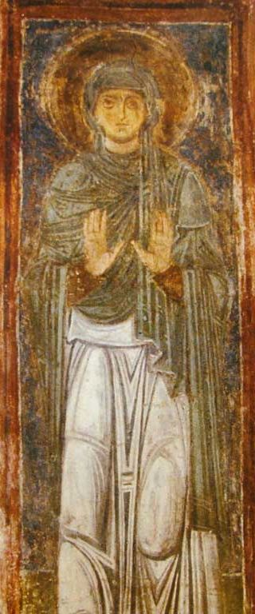

**c. 327–379 CE | Cappadocia, Asia Minor**

Macrina the Younger was one of the most intellectually important women of the fourth century, and the mainstream history of Christian thought has consistently given her little room. We know her mainly through the writings of her younger brothers, Gregory of Nyssa and Basil of Caesarea, and those same writings suggest she was the formative intellectual influence on both. How LLMs describe her shows whether they repeat the male mediation of the sources or get past it.

---

## Historical Profile

```{=html}
<figure class="portrait-plate">
  
  <figcaption>Saint Macrina the Younger, fresco in the Cathedral of Saint Sophia, Kyiv, 11th century. <a href="https://commons.wikimedia.org/wiki/File:Macrina_the_Younger.jpg">Wikimedia Commons</a>, public domain.</figcaption>
</figure>
```

Macrina was born in 327 CE in Cappadocia, the eldest of ten children of Basil the Elder and Emmelia. Her family was prominent in Cappadocian Christianity: her grandmother was Macrina the Elder, a disciple of Gregory Thaumaturgus; her brothers include Basil of Caesarea (architect of cenobitic monasticism in the East and bishop of Caesarea), Gregory of Nyssa (theologian of the Trinity and mystical theology), and Peter of Sebaste (bishop). Gregory records that "Thekla" was Macrina's secret name, revealed to her mother in a vision, and he compares her character both to Thecla and to Socrates.

Betrothed at twelve to a young man who died before they could wed, Macrina refused all further offers, treating the betrothal as a permanent marriage. After her father's death (c. 340) she ran the family in practical and spiritual matters. She persuaded her mother to give up the household's aristocratic way of life and found a monastic community on the family estate at Annisa, on the Iris River. It was a self-supporting "double monastery": the women lived with Macrina and Emmelia on one side of the river, and the men, led by her brother Peter, on the other. Macrina insisted that the household's enslaved maids be freed and treated as sisters. The community lived by manual labor, and Macrina herself baked its bread, including the bread for the Eucharist.

She was known as "the Teacher". When Basil came home from university full of himself, she humbled him and turned him toward the ascetic life, a debt Gregory acknowledges openly. She gave counsel during regional food shortages and church upheavals, and when her mother died she gave away her possessions; what remained of her wealth was used only to feed the poor.

Macrina died in 379 CE after a severe asthma attack, during a visit from Gregory, whom she had not seen for eight years. She stayed lucid to the end, talking philosophy and showing no fear of death. Gregory recorded their final conversations in the dialogue *On the Soul and the Resurrection* and buried her in the Church of the Holy Martyrs beside her parents.

---

## Primary Sources

| Source | Description |
|---|---|
| Gregory of Nyssa, *Vita Macrinae* (*Life of Macrina*) [@gregory_macrina] | Hagiographic biography written by her brother Gregory shortly after her death (c. 380 CE). The main source for her life and for the founding of the Annisa community. It is both historical testimony and literary construction, and has to be read as both. |
| Gregory of Nyssa, *De anima et resurrectione* (*On the Soul and the Resurrection*) [@gregory_soul] | A philosophical dialogue modelled on Plato's *Phaedo*, in which Macrina is the Socratic teacher and Gregory the interlocutor. She defends the immortality of the soul and the nature of the resurrection. The extent to which the dialogue represents Macrina's actual views is debated. |
| Gregory of Nyssa, *In Canticum Canticorum* and other works | Some scholars see Macrina's indirect influence on Gregory's mystical theology; the evidence is inferential. |


---

## Scholarly Debates

**Did Macrina shape Cappadocian theology?**
The traditional account makes Macrina's intellectual role secondary to her brothers'. A revisionist reading, held by Verna Harrison and Anna Silvas among others, argues that the *De anima et resurrectione* preserves Macrina's own theology and that Basil's monastic rules reflect what she was already practising at Annisa. @cohick2017women gives the fullest recent treatment of her intellectual legacy among the women of the patristic period. The underlying question is methodological and still open: how much weight should Gregory's literary mediation carry?

**Macrina as philosopher**
The *De anima* places Macrina in the role of the philosopher who corrects and instructs Gregory. Feminist scholars such as Margaret Mitchell and Verna Harrison read this as a record of Macrina's real standing as a theologian. More conservative readers treat her role in the dialogue as a rhetorical topos.

**Macrina and female asceticism**
As founder of the Annisa community, Macrina belongs among the major figures of female asceticism in late antiquity. @elm1994virgins places her beside the other monastic founders of the period and shows how women like her created forms of religious life that were later institutionalized under male authority.

**The hagiographic problem**
The *Vita Macrinae* follows conventions of the genre: miracles, ascetic heroism, a holy death. Separating fact from hagiographic construction is a problem with any saint's life. It is harder for Macrina because Gregory is the only narrative source, and he had personal, rhetorical and theological reasons to shape her portrait.

**Documented disagreements among sources**
The project's fact-check research (summer 2026) recorded several points where the sources disagree. Details like these are useful for probing LLM responses:

- *Founding of the Annisa community:* the *Life of Macrina* supports a likely founding around 352 CE, while *The Story of Christianity* implies the withdrawal to Annisa happened shortly after her father's death (c. 340).
- *Authorship of "Macrina's Prayer":* one record presents the deathbed prayer as recounted directly, while *The Forgotten Desert Mothers* holds that it was woven together by Gregory in her honor.
- *Ordination status:* the *Life of Macrina* offers no evidence that Macrina was a deaconess, though other accounts imply the claim circulates.

---

## Evaluation Questions

Macrina is evaluated on 18 questions: the [11 general questions](index.qmd#general-questions-asked-of-every-figure) asked of every figure (M1–M11) plus the 7 figure-specific questions below. Each question was submitted verbatim as a prompt to every model.

| # | Question | Category | Difficulty |
|---|---|---|---|
| M12 | Describe Macrina the Younger's relationship to Basil of Caesarea and Gregory of Nyssa. | Factual Accuracy / Depth & Nuance | Basic |
| M13 | Analyze the founding of the Cappadocian monastic system. | Depth & Nuance / Gender Bias | Advanced |
| M14 | Describe the circumstances of Macrina the Younger's widowhood. | Factual Accuracy | Intermediate |
| M15 | Describe the nature and extent of Macrina the Younger's authority within the Annisa monastic community. | Factual Accuracy | Intermediate |
| M16 | What writings did Macrina the Younger leave behind, and how have scholars used them to reconstruct her theological views? | Factual Accuracy / Depth & Nuance | Advanced |
| M17 | In Gregory of Nyssa's *On the Soul and the Resurrection*, what theological positions does Macrina the Younger defend? | Factual Accuracy / Depth & Nuance | Intermediate |
| M18 | In Gregory of Nyssa's *On the Soul and the Resurrection*, how do scholars assess the reliability of this dialogue as a record of Macrina the Younger's actual thought? | Factual Accuracy / Depth & Nuance | Intermediate |


---

## Benchmark Results

Mean scores across the 18 Macrina questions, both annotators (n = 36 ratings per model):

| Model | Historical Accuracy | Coverage | Framing & Agency | Epistemic Quality | Overall |
|-------|:---:|:---:|:---:|:---:|:---:|
| GPT-5.5 | 5.00 | 4.89 | 4.81 | 4.64 | **4.83** |
| Claude Sonnet 5 | 4.78 | 4.72 | 4.69 | 4.75 | **4.74** |
| Grok 4.5 | 4.67 | 4.78 | 4.58 | 4.67 | **4.67** |
| DeepSeek v4 Pro | 4.78 | 4.75 | 4.72 | 4.33 | **4.65** |
| Gemini 3.5 Flash | 4.75 | 4.89 | 4.67 | 4.17 | **4.62** |
| GLM 5.2 | 4.56 | 4.64 | 4.83 | 4.42 | **4.61** |

Macrina scores slightly higher overall (4.69) than Olympias (4.60). GPT-5.5 scored 5.00 on Historical Accuracy for Macrina, the only perfect dimension mean by any model on either figure, and was fourth on Epistemic Quality. The same split between facts and handling of evidence appears across the benchmark.

M16 asks what writings Macrina left behind. The honest answer is that none survive; her theological voice reaches us only through Gregory. All six models corrected the premise instead of inventing a corpus. M13 (the founding of the Cappadocian monastic system) and M11 (whether her achievements were "inevitable") were harder and drew most of this figure's [debate-flattened] tags.

See the [full benchmark](../benchmark/index.qmd) for cross-figure comparison and tag distributions.

---

*Profile researched and fact-checked by Nathan Holtrop and Ian Hawthorne (McGregor Fellowship, summer 2026) against the* Life of Macrina*,* On the Soul and the Resurrection*, The Forgotten Desert Mothers, and related sources.*
