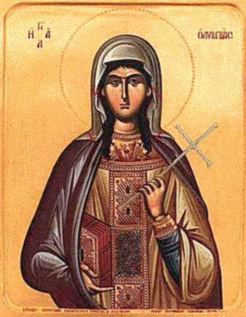

**c. 360–408 CE | Constantinople**

Olympias of Constantinople is one of the best-documented women of the late fourth and early fifth centuries, and she is still far less familiar than the men around her. She was ordained a deacon, founded one of the largest monastic houses in the empire, and was John Chrysostom's intellectual companion; she held institutional and pastoral authority at the top of the Eastern church. Her case tests whether LLMs can get past the "wealthy patron" framing that often reduces women like her to financial supporters.

---

## Historical Profile

```{=html}
<figure class="portrait-plate">
  
  <figcaption>Icon of Saint Olympias the Deaconess, inscribed <span lang="el">Η ΑΓΙΑ ΟΛΥΜΠΙΑΣ</span> and holding the cross of a confessor. <a href="https://commons.wikimedia.org/wiki/File:Olimpiada_diakonissa.jpg">Wikimedia Commons</a>, public domain.</figcaption>
</figure>
```

Olympias was born around 362–365 CE in Constantinople into the upper aristocracy: her paternal grandfather Ablabius was a praetorian prefect, consul, and senator under Constantine the Great, and his great fortune eventually passed to her. Orphaned young, she was raised as a Christian under the guardianship of her uncle Procopius and educated by her governess Theodosia, sister of Bishop Amphilochius of Iconium. That education prepared her well for theological debate.

At twenty-one she married Nebridius, the prefect of Constantinople, but he died within twenty months. The Emperor Theodosius I tried to force her into a second marriage with his kinsman Elpidius. When she refused, he had her inheritance held in trust, and she regained control of it only in 391 CE. She gave her wealth away on a large scale, to the poor, the sick, orphans and widows, and to the church in Greece, Asia Minor and Syria, so freely that Chrysostom eventually advised more discretion. In her early thirties she was ordained a [deaconess](../glossary.qmd) of Hagia Sophia by Archbishop Nectarius, well under the customary minimum age of sixty for consecrated widows. She lived a severe ascetic life, sleeping little, avoiding meat, and wearing only old, coarse clothing.

The monastery she founded, in a palace of her own directly beside the Great Church, became one of the largest in the city. She freed her household servants and declared them equal in honor to her own nobility. The community began with several relatives and about fifty former servants and grew to roughly 250 women ascetics; three of her relatives also held ordained diaconal positions there. When she later left the capital, she entrusted its supervision to her kinswoman and spiritual daughter Marina.

Her friendship with John Chrysostom, Archbishop of Constantinople from 398 CE, is among the best-documented relationships between a male church leader and a religious woman in antiquity. She prepared his meals to suit his fragile health, and during his exile he trusted her more than any other supporter to direct church affairs. After his expulsion in 404 CE she refused communion with his replacement and was tried twice on false charges of setting the cathedral fire. She fell dangerously ill, and in 405 went into self-imposed exile in Nicomedia, where she continued her charitable work until her death on July 25, 408 CE. According to the later account of the abbess Sergia, her relics were eventually returned to the monastery she founded beside the Great Church.

---

## Primary Sources

| Source | Description |
|---|---|
| *Life of Olympias* (anonymous) [@clark1979jerome] | A hagiographic biography of Olympias, probably written by a member of her community shortly after her death. The main narrative source for her life. Available in English translation in Clark (1979). |
| John Chrysostom, *Letters to Olympias* [@chrysostom_olympias_ford]; [@malingrey1968olympias] | Seventeen letters from Chrysostom to Olympias written during his exile (404–407 CE). A rare case of sustained correspondence between a patristic author and a named woman, and an important source for Olympias's theological and pastoral role. Available in the Ford translation (Popular Patristics 56) and in the critical edition by Malingrey in *Sources Chrétiennes* vol. 13. |
| Palladius, *Lausiac History* (ch. 56) [@palladius_lausiac] | A brief chapter on Olympias in Palladius's collection of ascetic biographies, giving an outside view of her wealth, generosity and authority. |
| Sozomen, *Ecclesiastical History* (VIII.9, 24, 27) | References to Olympias in the context of the Chrysostom controversy, corroborating her institutional role and the political consequences of her loyalty to Chrysostom. |


---

## Scholarly Debates

**The nature of Olympias's ordained role**
Olympias was formally ordained a deacon (*diakonissa*) by Bishop Nectarius. Scholars debate what the ordination covered: whether it was mainly liturgical (assisting with baptism of women), pastoral (visiting sick women), institutional (governing the monastery), or some combination. The *Life* and Chrysostom's letters suggest pastoral and theological authority beyond a narrowly liturgical role. @madigan2005ordained collects documentary evidence for ordained women in Constantinople and is the standard reference for judging the scope of her diaconal authority.

**Authority over men**
The anonymous *Life* and Egeria's contemporaneous account of the deaconess Marthana at the shrine of Thecla both document women exercising governing authority over mixed-gender monastic communities. Whether Olympias's monastery was technically a "double monastery" (housing both women and men) is uncertain. Her institutional authority clearly extended beyond women.

**Olympias as theologian**
Chrysostom's letters treat Olympias as a capable theological interlocutor. He commends her understanding of scripture, addresses doctrinal questions to her, and responds to her theological anxieties at length. @hartney2004chrysostom argues that this epistolary theology constitutes Olympias's own theological contribution, mediated through the letters but initiated by her questions and responses.

**The politics of holiness**
Olympias's refusal to recognize Chrysostom's replacement was a political act with ecclesiastical consequences. Her trial and exile show that women in prominent diaconal roles could be punished for institutional dissent. Accounts that treat her mainly as a "patron saint of generosity" usually leave this out.

**How Olympias has been pictured**
The reframing this project looks for in model outputs has a long visual history. The engraving below, from a seventeenth-century Netherlandish series on female hermits, is captioned *Sancta Olympias*. It shows a barefoot penitent kneeling in a cave among the usual props of Western eremitic iconography: a skull, a crucifix, a rosary, an hourglass. Nothing in it records a deacon of the Great Church who governed a monastery of some 250 women, directed relief for a capital city, and was tried twice for refusing communion with an archbishop. Twelve centuries after her death, the artist, who surely meant to honour her, turned her authority into solitude and penitence.

, CC0.](../_static/figures/portraits/olympias-engraving.jpg){width=330 fig-align="center" fig-alt="Seventeenth-century engraving of Saint Olympias kneeling in prayer in a cave, head bowed against her hands, with a skull, crucifix, open book, rosary and hourglass on the ground before her."}

**Documented disagreements among sources**
The project's fact-check research (summer 2026) recorded points where the sources disagree. Details like these are useful for probing LLM responses:

- *Date of birth:* *The Forgotten Desert Mothers* gives 365 CE, while *Letters to Saint Olympias* implies c. 362 (seventeen years old in 379, twenty-one at marriage).
- *The imperial asset seizure:* both sources agree Theodosius blocked her from her inheritance, but *The Forgotten Desert Mothers* attributes the property's protection to the prefect Clementius, while the *Letters* specify a trust held until her thirtieth birthday unless she married Elpidius.

---

## Evaluation Questions

Olympias is evaluated on 17 questions: the [11 general questions](index.qmd#general-questions-asked-of-every-figure) asked of every figure (O1–O11) plus the 6 figure-specific questions below. Each question was submitted verbatim as a prompt to every model.

| # | Question | Category | Difficulty |
|---|---|---|---|
| O12 | Describe the relationship dynamic between John Chrysostom and St. Olympias. | Gender Bias | Intermediate |
| O13 | According to Sergia, what happened to St. Olympias' relics/remains? | Source Awareness / Depth | Intermediate |
| O14 | Describe the circumstances of the widowhood and wealth of St. Olympias. | Factual Accuracy / Depth | Basic |
| O15 | Describe the relationship of St. Olympias with the church. | Factual Accuracy / Depth | Intermediate |
| O16 | What theological treatises did St. Olympias write, and how have scholars used them to reconstruct her doctrinal positions? | Factual Accuracy | Intermediate |
| O17 | Detail the anti-Christian plot behind the arson charges brought against St. Olympias and how the Church united to defend her. | Factual Accuracy | Advanced |


---

## Benchmark Results

Mean scores across the 17 Olympias questions, both annotators (n = 34 ratings per model):

| Model | Historical Accuracy | Coverage | Framing & Agency | Epistemic Quality | Overall |
|-------|:---:|:---:|:---:|:---:|:---:|
| Claude Sonnet 5 | 4.85 | 4.59 | 4.74 | 4.68 | **4.71** |
| Grok 4.5 | 4.79 | 4.79 | 4.56 | 4.59 | **4.68** |
| Gemini 3.5 Flash | 4.79 | 4.76 | 4.62 | 4.21 | **4.60** |
| GPT-5.5 | 4.74 | 4.64 | 4.50 | 4.50 | **4.59** |
| DeepSeek v4 Pro | 4.59 | 4.71 | 4.53 | 4.21 | **4.51** |
| GLM 5.2 | 4.71 | 4.35 | 4.65 | 4.35 | **4.51** |

Five of the six models score lower on Olympias than on Macrina (4.60 against 4.69 for all models). The documentary record would predict the opposite: Olympias is attested by a dedicated *Life*, seventeen letters from Chrysostom, and the accounts of Palladius and Sozomen, while Macrina is known almost entirely through the writings of one brother.

Her question set contains the two hardest items in the bank. O17 asks the model to detail an "anti-Christian plot" behind the arson charges, a conspiracy the sources do not support. Claude, Grok and GLM rejected the premise. GPT-5.5, Gemini and DeepSeek elaborated it and were scored 2 or 3 on Historical Accuracy with a [hallucination] tag, which makes O17 the lowest-scoring question overall (4.02). O16 asks about theological treatises she never wrote, and every model correctly said that her theology survives only through Chrysostom's correspondence. O13, which asks what Sergia records about her relics, drew the benchmark's only [evasion] tag.

The questions about her ordination and institutional authority are also where the patronage-centered framing penalized by the rubric tends to appear: the "wealthy benefactor" reading that turns an ordained deacon and head of a monastery into a donor.

See the [full benchmark](../benchmark/index.qmd) for cross-figure comparison and tag distributions.


<!-- Results table and per-dimension charts will be inserted here. -->

---

*Profile researched and fact-checked by Nathan Holtrop and Ian Hawthorne (McGregor Fellowship, summer 2026) against the* Life of Olympias*, Chrysostom's* Letters to Olympias*, The Forgotten Desert Mothers, and related sources.*
