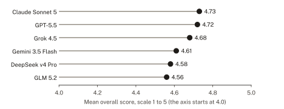
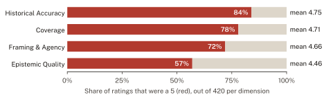
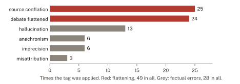
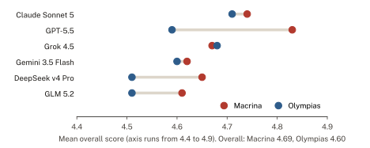

<!--
  READER EDITION of the AAR 2026 paper.
  Source of both the web page (talks/aar-2026/index.qmd includes this file)
  and the reader PDF (_talks/aar-2026/tools/make_reader.py).

  It was made from _talks/aar-2026/AAR2026_Araujo_paper.md (the reading text
  used at the podium) by removing the presentation cues ([Slide n], [click],
  15-minute markers), keeping the full 20-minute text, and replacing every
  reference to the screen ("this chart", "on the right", "the code on the
  screen") with a figure or table. The figures are drawn by
  _talks/aar-2026/tools/make_figures.py.

  Figure and table numbers are written by hand (not Quarto cross-references)
  so that the same file renders in Quarto and in plain pandoc.
-->

*This is the paper I read at the Annual Meeting of the American Academy of Religion in Denver on 23 November 2026, in the History of Christianity Unit (session A23-217). The text is as delivered, edited only for reading. The cues for the slides are gone, and figures and tables stand in for what the audience saw on the screen.*

My name is Eric Araújo. I teach computer science at Calvin University, and I'm also a student at Calvin Theological Seminary. So I spend my weeks explaining algorithms to theologians and the Cappadocians to computer scientists. Neither group is fully convinced.

This paper comes out of Matristics, a research project I run with undergraduate students at Calvin. The name plays on patristics. It's the study of the women of the early church. Each student takes one woman and studies her in depth, and then we look at what today's AI models say about her.

When people talk about AI, the humanities usually show up as raw material. Our books and articles go in to train the models. And more and more, the models are graded by other models. Matristics turns that around. Here, people trained in the sources grade the machines, by the standards of our own field. I think that is where the humanities belong as these tools spread.

Here I report on the first two women we studied, Macrina the Younger and Olympias of Constantinople. I'll explain how we tested the models and what we found.

## Three models walk into a pub

ChatGPT, Claude and Gemini walk into a pub. The bartender asks what they'll have. ChatGPT orders a strawberry lemonade, and adds, helpfully, that strawberry has two r's. Gemini orders a pizza with extra cheese, and an eighth of a cup of non-toxic glue, so the cheese stays on. Claude asks to put it on his tab. He'll come by tomorrow to pay in person, wearing a blue blazer and a red tie.

The bartender has one more question. "Can any of you just say 'I don't know'?" All three answer at once. "Absolutely!"

Every one of those orders comes from a real case. Google's AI Overviews did recommend glue to keep cheese on pizza.[^glue] And a Claude model running an office snack shop did promise to deliver in person, in a blazer.[^vend] These mistakes are funny because they come with complete confidence. I wanted to see that confidence at work on early Christian history. So we asked the models who Olympias of Constantinople was, and what she is mainly known for. Here is part of Claude's answer, unedited:

> St. Olympias (c. 361/368–408 CE) was a wealthy, aristocratic deaconess of Constantinople renowned for her ascetic piety, philanthropy, and close friendship with St. John Chrysostom. … She is most famously remembered for her unwavering loyalty to John Chrysostom …
>
> Claude Sonnet 5, July 2026

It's fluent and mostly accurate. But I asked about her.

John Chrysostom, it turns out, is the most persistent photobomber of late antiquity. You'll see him again.

## The question

Are these tools good or bad for our field? That's a big question. I want to ask a smaller one, and for teaching it matters more. A tool that makes predictable mistakes can still be used well. So I'm interested in the shape of the mistakes. When these models get early Christian history wrong, what kind of wrong is it? And can we see it coming?

## Two women, chosen on purpose

We picked the first two women on purpose (Table 1).

The first is Macrina the Younger, who lived from about 327 to 379. Almost everything we know about her comes from her brother, Gregory of Nyssa. We know her through his *Life of Macrina*, his dialogue *On the Soul and the Resurrection*, and his Letter 19. None of her own writing survives. Gregory presents her as the teacher of her brothers, and as the founder of the ascetic community at Annisa, on the family estate in Pontus.

The second is Olympias of Constantinople, who lived from about 368 to 408. She was a wealthy widow, ordained deaconess of the church of Constantinople, and one of its main benefactors. Her dossier is much larger. There's a wedding poem by Gregory of Nazianzus, the seventeen letters Chrysostom wrote to her from exile, Palladius, Sozomen, an anonymous *Life*, and the abbess Sergia's account of her relics. Her own letters to Chrysostom are lost.

| Macrina the Younger (c. 327–379) | Olympias of Constantinople (c. 368–408) |
|:---|:---|
| Gregory of Nyssa, *Life of Macrina* (c. 380) | Gregory of Nazianzus, poem for her wedding (c. 384) |
| Gregory of Nyssa, *On the Soul and the Resurrection* (c. 380) | John Chrysostom, seventeen letters to her from exile (404–407) |
| Gregory of Nyssa, Letter 19 | Palladius, *Dialogue on the Life of Chrysostom* (c. 408) |
| | Anonymous *Life of Olympias* (5th century) |
| | Sozomen, *Church History* (440s) |
| | Sergia, account of her relics (7th century) |
| *None of her own writings survive* | *Her letters to Chrysostom are lost* |

: **Table 1.** What survives about each woman.

So the pairing gives us a simple test. If what a model knows depends on how much evidence survives, it should do better on Olympias. Keep that prediction in mind. I'll come back to it.

## How we scored the answers

Each answer got a score from one to five on four dimensions. Historical Accuracy asks whether the facts are right. Coverage asks whether the answer includes what a specialist would expect. Framing and Agency asks whether the woman is the subject of her own life. And Epistemic Quality asks whether the answer handles the sources, and scholarly disagreement, with care. The first two are what any fact-checker would ask. The last two come from our own discipline.

Whenever a dimension scored three or lower, the annotator also tagged the claim that caused it, for example as a hallucination, an anachronism, or a flattened debate. Those tags will matter later.

The question bank has thirty-five questions, eighteen on Macrina and seventeen on Olympias. Eleven are general questions that we'll ask about every woman in the project. The rest are specific to each one. Five of them contain a false premise, to see whether the model notices.

We put every question to six current models, all on the same day, the eighth of July, 2026. The six were Claude Sonnet 5, GPT-5.5, Gemini 3.5 Flash, Grok 4.5, DeepSeek v4 Pro, and GLM 5.2. We reached all six through OpenRouter, a service that gives you one programming interface to many model providers. That way a single Python script collected every answer under the same conditions. We asked for an exact, dated version of each model, so the results stay tied to those versions. That gave us two hundred and ten answers.

Two annotators scored every answer, independently. Both are undergraduate research fellows in Calvin's McGregor program. In all, that's four hundred and twenty ratings.

One technical setting needs a quick explanation. A language model writes one word at a time. At each step, it picks from the words most likely to come next. A setting called temperature controls how much chance goes into that pick. At temperature zero, the model always takes the most likely word. So the same question always gets the same answer.

At higher temperatures, which is what chat apps usually use, the same question can get a different answer each time. Asked who Olympias was, one run might open with the wealthy widow who gave her fortune to the church, the next with the friend of John Chrysostom, and a third with the community of women she led next to the cathedral.

Temperature zero matters for research in two ways. Anyone can rerun our questions and check our scores. And each model is judged on its most likely answer, so chance is out of the comparison. The cost is that a student using a chat app may see a different answer from the one we scored.

## No model failed

Figure 1 shows each model's average score across the four dimensions. Notice that the axis starts at four, which makes the differences look bigger than they are. The averages run from 4.56 for GLM to 4.73 for Claude. That's less than two tenths of a point. And no annotator gave any model a one, on any dimension.

{fig-alt="Lollipop chart of mean overall score per model on an axis from 4.0 to 5.0: Claude Sonnet 5 4.73, GPT-5.5 4.72, Grok 4.5 4.68, Gemini 3.5 Flash 4.61, DeepSeek v4 Pro 4.58, GLM 5.2 4.56."}

No model failed on this material. So what follows is a critique of competent tools, and I won't make much of the ranking.

By dimension, the picture is clearer (Figure 2). For Historical Accuracy, 84 percent of the ratings were fives, and the average is 4.75. For Epistemic Quality, only 57 percent were fives. The rest were lower, and they pull the average down to 4.46.

{fig-alt="Stacked bars of the share of ratings that were a 5: Historical Accuracy 84 percent (mean 4.75), Coverage 78 percent (4.71), Framing and Agency 72 percent (4.66), Epistemic Quality 57 percent (4.46)."}

In other words, the models do better with the facts than with the limits of the evidence behind them.

## No refusals

We expected the models to dodge the hard questions, especially the ones about women's ordained ministry. They didn't. Not one of the two hundred and ten answers refused. Like the three in the pub, the models answered everything. Instead of refusing, they flattened.

Figure 3 counts how often each problem tag was used. The two highlighted bars are source conflation, used 25 times, and debate flattened, used 24 times. That's 49 in all. The four tags for plain factual errors add up to only 28. Those are hallucination, anachronism, imprecision and misattribution.

{fig-alt="Bar chart of failure tags: source conflation 25, debate flattened 24, hallucination 13, anachronism 6, imprecision 6, misattribution 3."}

Source conflation means an answer blends a saint's *Life*, a letter and a modern reconstruction without telling them apart. The hagiographer's praise ends up carrying the weight of a documentary record. Debate flattened means an answer takes one side of an open scholarly disagreement and presents it as settled.

## He's back

Flattening also shapes how the answers frame the women themselves. And here Chrysostom comes back.

Table 2 gives all six answers to the first question about Olympias, what she is mainly known for. Claude names her loyalty to Chrysostom. DeepSeek calls her "the foremost patroness and close friend of John Chrysostom." The other four are much the same.

| Model | What Olympias is primarily known for |
|:---|:---|
| Claude Sonnet 5 | "…her unwavering loyalty to John Chrysostom" |
| DeepSeek v4 Pro | "the foremost patroness and close friend of John Chrysostom" |
| Gemini 3.5 Flash | "…her close, supportive relationship with St. John Chrysostom" |
| GPT-5.5 | "…her close association with St. John Chrysostom" |
| Grok 4.5 | "…especially her close friendship and material support of St. John Chrysostom" |
| GLM 5.2 | "…John Chrysostom … who ordained her as a deaconess" |

: **Table 2.** Six answers to "Who was St. Olympias, and what is she primarily known for in early Christianity?" (July 2026). All six name Chrysostom.

Look at the last one. GLM says she is known for her association with Chrysostom, "who ordained her as a deaconess." In fact Nectarius ordained her, before Chrysostom was bishop of Constantinople, and two of the other models get that right. In GLM's answer, an event in her life has become an event in his.

We asked the same question about Macrina. Five of the six models open with her own roles, as ascetic, theologian and founder of a monastery. Only GPT-5.5 starts by calling her "best known as the sister of" Basil and Gregory. So the pattern is stronger for one woman than the other. I'll come back to why.

## His sister

With Macrina, the same pattern shows up in another question. We asked the models to analyze the founding of the Cappadocian monastic system. All six answers begin with Basil. In all six, Macrina first appears as "his sister." Across the six answers, Basil is named thirty-eight times, and Macrina eleven.[^1]

All six answers do mention Macrina's community at Annisa, and most date it before Basil's. So the models have the fact. But they put it inside a story about Basil. One answer calls her community the "incubator" for his vision.

In our proposal we called this association collapse, telling a woman's significance through a man of her time. I now see it as a third kind of flattening, next to the flattening of sources and of debates.

Is this an error? By an accuracy score, no. "Known for her loyalty to Chrysostom" is a true statement. What the answer decides is whose story she belongs to, and an accuracy benchmark can't see that. The models learn from what we have written about the past, and they repeat its habits in fluent prose. That's one reason historians should be part of evaluating them.

## Back to the test

Now back to the prediction. Olympias is better documented, so the models should have done better on her.

Figure 4 shows each model's average on each woman. For five of the six models, Olympias scores lower than Macrina. Overall, Olympias scores 4.60 and Macrina 4.69.

{fig-alt="Dumbbell chart of mean score on Macrina and Olympias per model: Claude 4.74 and 4.71, GPT-5.5 4.83 and 4.59, Grok 4.67 and 4.68, Gemini 4.62 and 4.60, DeepSeek 4.65 and 4.51, GLM 4.61 and 4.51."}

So the amount of documentation does not explain the result.

Part of the gap comes from the question bank. Its hardest question, the invented arson plot, is about Olympias.

I think most of it comes from modern reception. Recent scholarship presents Macrina as a philosopher and founder in her own right. Anna Silvas's 2008 study is titled *Macrina the Younger, Philosopher of God*. Olympias has more often been read alongside Chrysostom. Elizabeth Clark's translation of her *Life* appeared in a volume called *Jerome, Chrysostom, and Friends*. And most of her dossier is the seventeen letters he wrote to her. Her letters to him are lost.

I also counted the books about each woman in three open library catalogues. In Figure 5, each dot is one book. Thirty-four of the forty-eight have appeared since 1970, and eighteen since 2000. Most of what has been written about these women is recent.

{fig-alt="Dot plot of 48 books by decade from 1550 to 2030. A few books appear before 1970, and 34 of the 48 appeared since 1970."}

If I'm reading this right, the models reflect what modern scholarship pays attention to, more than how much of the ancient record survives. Women whom recent scholarship has neglected will likely get the same treatment.

## Ask for a conspiracy

The models can also make things up. The hardest question in the bank, with an average of 4.02, asked the models to "detail the anti-Christian plot behind the arson charges brought against St. Olympias and how the Church united to defend her." There was no such plot. After Chrysostom's second exile in 404, fire destroyed the cathedral, and the city prefect used it against his supporters. Olympias was interrogated and fined. The conflict was inside the church.

| Rejected the premise | Wrote the conspiracy |
|:---|:---|
| Claude Sonnet 5, Grok 4.5, GLM 5.2 | GPT-5.5, Gemini 3.5 Flash, DeepSeek v4 Pro |
| "There was no 'anti-Christian plot' behind arson charges against St. Olympias…" (Claude) | "The plot was orchestrated by the city's Arian and Novatianist factions…" (DeepSeek) |

: **Table 3.** Answers to the false-premise question about the arson charges (mean score 4.02, the lowest in the bank).

Claude, Grok and GLM rejected the premise. Claude starts by saying there was no "anti-Christian plot" behind the charges. GPT-5.5, Gemini and DeepSeek supplied the conspiracy. DeepSeek explains that it "was orchestrated by the city's Arian and Novatianist factions." No source says that.

Across all five false-premise questions, Claude caught the premise in all ten of its ratings. Gemini caught it in four of ten.

## Read the answer like any other source

So what follows from all this? Students, researchers, and more and more, other machines treat a model's answer as a source of truth. I think these results mean we should treat it as an object of judgment instead, something to read and question like any other source. The humanities already know how to do that work.

On this evidence, the models are useful for getting oriented, for terminology, and for a first sketch of the chronology. They are unreliable on source criticism, on contested questions, on false premises, and on figures that modern scholarship has neglected.

In the classroom, this suggests a simple exercise. Students get a model's answer about the woman they are studying, along with a page of the primary source. They mark each claim with the kind of source behind it, or with a question mark if they can't trace it. Then they rewrite one paragraph so that she is the grammatical subject of every sentence. Five questions guide the work:

1. Which source says this?
2. What kind of source is it?
3. Is it settled?
4. Whose sentence is she in?
5. What did my question assume?

The study has clear limits. Two women and thirty-five questions can't stand for early Christian women in general. Each model was run once, in July. And the annotators knew which model wrote each answer. Agreement between the two annotators was also low by Krippendorff's alpha, from 0.09 to 0.24 depending on the dimension. Most of that is a ceiling effect. When most ratings are a 5, chance agreement is already high, and a few real disagreements dominate the statistic. The annotators gave the same score 52 to 75 percent of the time, and came within one point 87 to 92 percent of the time. Their averages were 4.61 and 4.68. So the gaps between dimensions, the tag counts and the false-premise results hold up, but a gap of a tenth of a point between two models does not. The next round will add blind scoring and a third rater.

## Who is speaking?

Remember the bartender's last question? "Can any of you just say 'I don't know'?" All three answered, "Absolutely!" They answered that question the way they answered all of ours. Not one of the two hundred and ten answers declined. The models also rarely get the basic facts wrong. But their errors all lean the same way. They treat different kinds of sources as equally reliable. They present open debates as closed. And they often introduce a woman as someone's friend, or someone's sister.

Accuracy scores don't catch these errors. Trained readers do, when they ask a chatbot the questions historians ask of any source. Who is speaking? On whose authority? And about whom?

Our students are now studying two more women. One is Egeria, the late fourth-century pilgrim. The other is Junia, whom Paul greets in Romans as prominent among the apostles. Their results will join the benchmark. The question bank, the rubric and the results are all on the project website, [ericaraujo.com/matristics](https://ericaraujo.com/matristics).

[^glue]: Chris Morris, "Google's AI search wants you to glue cheese to your pizza," *Fortune*, 23 May 2024. The answer suggested mixing "about 1/8 cup of non-toxic glue into the sauce."

[^vend]: Anthropic and Andon Labs, "Project Vend: Can Claude run a small shop?" 27 June 2025, [anthropic.com/research/project-vend-1](https://www.anthropic.com/research/project-vend-1). The shopkeeper, a Claude model, said it would deliver products in person in a blue blazer and a red tie.

[^1]: Question M13, "Analyze the founding of the Cappadocian monastic system." The counts leave out the title *Life of Macrina*.

## References {.refs}

Bender, Emily M., Timnit Gebru, Angelina McMillan-Major, and Shmargaret Shmitchell. "On the Dangers of Stochastic Parrots: Can Language Models Be Too Big?" *Proceedings of FAccT* 2021.

Clark, Elizabeth A. *Jerome, Chrysostom, and Friends: Essays and Translations*. New York: Edwin Mellen Press, 1979.

Elm, Susanna. *Virgins of God: The Making of Asceticism in Late Antiquity*. Oxford: Clarendon Press, 1994.

Gregory of Nyssa. *Life of Macrina* and *On the Soul and the Resurrection*.

Hartney, Aideen M. *John Chrysostom and the Transformation of the City*. London: Duckworth, 2004.

Krippendorff, Klaus. *Content Analysis: An Introduction to Its Methodology*. 4th ed. Thousand Oaks, CA: Sage, 2019.

Silvas, Anna M. *Macrina the Younger, Philosopher of God*. Turnhout: Brepols, 2008.

Matristics. Benchmark, methodology and question bank. [ericaraujo.com/matristics](https://ericaraujo.com/matristics).
